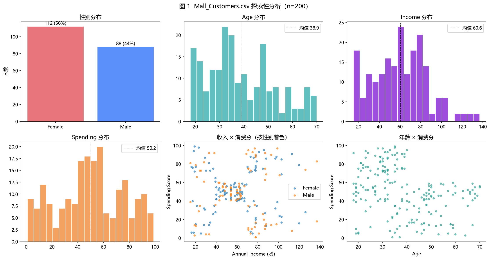
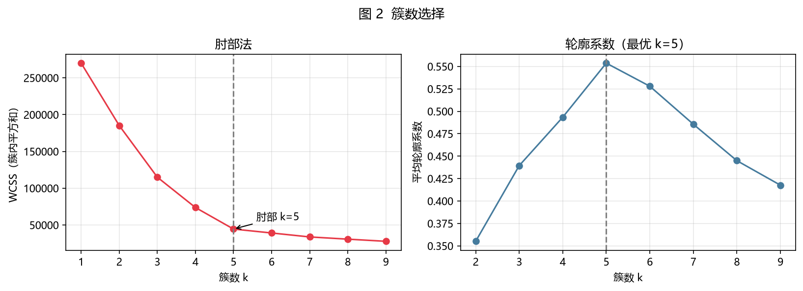
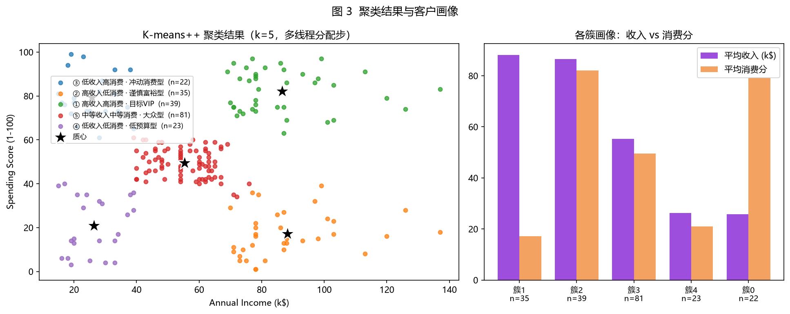
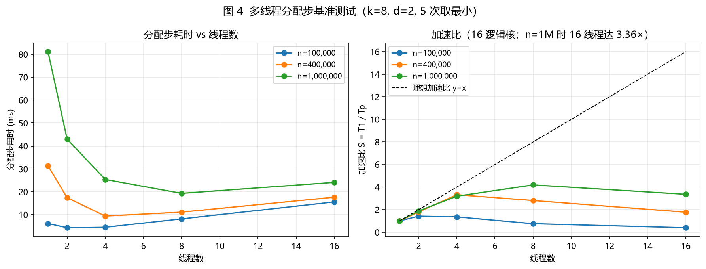

# K-means++ 多线程分配步实现与数据集聚类分析报告

> **任务**：实现 K-means++ 算法中**分配步（Assignment Step）**的多线程程序；自行从 Kaggle 选取数据集，完成聚类分析并将分析结果写入本文档。
>
> **代码**：`kmeans_parallel.py`（核心算法库 + 自检 + 基准）、`run_analysis.py`（数据分析全流程）
> **数据集**：[Mall Customer Segmentation Data](https://www.kaggle.com/datasets/vjchoudhary7/customer-segmentation-tutorial-in-python)（经 kagglehub 匿名下载）
> **环境**：Windows × 16 逻辑核 · Python 3.11.9 · numpy 2.4.6 · pandas 2.3.3 · matplotlib 3.11.2

---

## 1. 任务概述

K-means（Lloyd 迭代）每一轮分两步：

1. **分配步（本程序并行化的目标）**：固定质心，把每个样本指派到最近质心；
2. **更新步**：固定簇划分，把质心移到各簇均值。

分配步的复杂度为 **O(n·k·d)**（n 样本数、k 簇数、d 维度），且各样本的计算**完全独立**，是典型的"易并行"问题，也是 K-means 每轮迭代的计算瓶颈——因此把它作为多线程化的对象。更新步计算量小（O(n·d)），保持串行即可。

本项目交付内容：

| 交付物 | 说明 |
|---|---|
| `assignment_step(X, C, n_threads)` | ★多线程分配步：块状划分 + 线程池，`n_threads=1` 时退化为单线程版（正确性对照） |
| `kmeans_pp_init` | K-means++ 初始化（D² 概率采样） |
| `kmeans_fit` | 完整聚类流程：++ 初始化 + Lloyd 迭代（并行分配 + 串行更新）+ 双重收敛判据 |
| `silhouette_score` | 轮廓系数（手写实现，不依赖 sklearn） |
| `benchmark_assignment` | 分配步基准：不同样本规模 × 不同线程数的用时 / 加速比 |
| 数据分析 | EDA → 选 k（肘部 + 轮廓系数）→ 客户细分画像 → 性能基准（4 张图 + 4 张数值表） |

---

## 2. 算法原理

### 2.1 分配步的数学形式

给定质心矩阵 $C \in \mathbb{R}^{k \times d}$，对每个样本 $x_i$ 求：

$$\text{label}(i) = \arg\min_{j \in [1,k]} \lVert x_i - c_j \rVert^2, \qquad d_i^2 = \min_j \lVert x_i - c_j \rVert^2$$

其中 $d_i^2$ 累加即得目标函数 **WCSS**（簇内平方和，肘部法用）。

直接按定义逐对相减需要 O(n·k·d) 的三维广播中间数组（n×k×d 的临时内存）。本实现改用恒等式：

$$\lVert x-c \rVert^2 = \lVert x \rVert^2 - 2\,x\cdot c + \lVert c \rVert^2$$

于是距离矩阵可写成**一次矩阵乘** $D = -2\,XC^{\top} + \lVert c \rVert^2 + \lVert x \rVert^2$（BLAS `dgemm`），时间与内存都显著更优，且矩阵乘会释放 Python GIL——这正是线程能真正并行的前提（见 §3.2）。

### 2.2 K-means++ 初始化

朴素随机取点可能让初始质心扎堆。K-means++ 按与已有质心的最小距离平方成比例的概率（D² 采样）逐个选取质心，理论上保证初始质心互相散开、期望 WCSS 不超过最优解的 O(log k) 倍。初始化本身只有 O(n·k·d) 的一次性开销，保持串行。

---

## 3. 多线程设计与实现

### 3.1 总体方案：数据分块 + 线程池

```python
def assignment_step(X, C, n_threads=1, chunks_per_thread=8):
    ...
    csq = (C * C).sum(axis=1)                       # ‖c_j‖²，(k,)
    n_chunks = max(1, n_threads * chunks_per_thread)  # 块数 = 8×线程数
    chunk  = max(1, ceil(n / n_chunks))
    bounds = [(s, min(s+chunk, n)) for s in range(0, n, chunk)]

    def _task(s, e):                                # 一个块 = 一个任务
        xsq = np.einsum("ij,ij->i", X[s:e], X[s:e]) # ‖x‖²
        D = X[s:e] @ C.T                            # (m,k) BLAS 矩阵乘，释放 GIL
        D *= -2.0; D += csq; D += xsq[:, None]
        np.maximum(D, 0.0, out=D)                   # 截断浮点负误差
        labels[s:e] = D.argmin(axis=1)              # 各线程写各自区间
        d2min[s:e]  = D.min(axis=1)

    with ThreadPoolExecutor(max_workers=n_threads) as pool:
        futures = [pool.submit(_task, s, e) for s, e in bounds]
        for f in futures: f.result()
```

设计要点及理由：

1. **块数远多于线程数（8×）**：任务进入线程池队列，先完成的线程自动领取下一块，实现**动态负载均衡**——避免某块恰好被 OS 调度抢占/落在慢核上造成长尾等待。
2. **每个 worker 是操作系统级线程**（`ThreadPoolExecutor` 底层为 OS 线程池），不是协程。
3. **线程安全无需加锁**：`labels`/`d2min` 按块**不相交切片**写入（disjoint slice，无扩容、无交叉），每个线程只触碰自己的内存区间。
4. **收敛判据双重化**：`kmeans_fit` 同时检测①所有样本的簇分配不再变化（Lloyd 标准停机条件）②质心最大位移 ≤ tol。仅用极小的 tol 会在边界点来回翻转时永不停止（实测教训，见 §3.4）。
5. **空簇处理**：更新步发现某簇无样本时，把离质心最远的样本重新播种到该簇，保证最终恰好 k 个非空簇。

### 3.2 为什么 Python 线程能真正并行？——GIL 与 numpy

CPython 有全局解释器锁（GIL），纯 Python 字节码同一时刻只能在一个线程执行。但 numpy 在执行**大数组的 BLAS 运算（如矩阵乘）与 ufunc** 时会**主动释放 GIL**，多个线程的 `X[s:e] @ C.T` 因此可以在不同物理核上同时运行。这是"Python 多线程做数值计算"可行的根本原因；反过来，若用纯 Python 循环实现距离计算，多线程将毫无收益。

### 3.3 基准测试的公平性保障

若不加以控制，OpenBLAS/MKL 自身会按 CPU 核数开多线程，与我们的线程池混叠，测出的"加速比"无法归因。因此**在 import numpy 之前**钉死：

```python
for v in ("OMP_NUM_THREADS", "OPENBLAS_NUM_THREADS", "MKL_NUM_THREADS", ...):
    os.environ.setdefault(v, "1")
```

这样测得的加速完全来自本程序的线程池。计时采用"预热 1 次 + 重复 5 次取最小"，抑制线程池冷启动与 OS 抖动。

### 3.4 正确性验证

`python kmeans_parallel.py --selftest`，全部通过：

- **逐元素一致**：5 万样本 × 6 维随机数据上，多线程（8/16 线程）的 `labels` 与向量化单线程实现**完全相等**，距离平方 `allclose` 至 1e-8；且与最直观的三维广播对照实现一致。
- **完整流程**：5 个分离高斯团（n=50 000, d=6）上 `kmeans_fit(k=5)` **2 轮收敛**，产生 5 个非空簇，WCSS 从 444 196 → 191 713。
- 调试中发现的一个算法特性值得一提：若自检数据用**单一高斯云**（无真实簇结构），边界点会每轮翻转、永不收敛——这是 Lloyd 算法在无簇结构数据上的固有行为，不是并行实现的缺陷（多线程与单线程标签始终逐元素一致）。

---

## 4. 数据集介绍

| 项 | 内容 |
|---|---|
| 名称 | Mall Customer Segmentation Data（商场客户细分） |
| 来源 | [kaggle.com/datasets/vjchoudhary7/customer-segmentation-tutorial-in-python](https://www.kaggle.com/datasets/vjchoudhary7/customer-segmentation-tutorial-in-python) |
| 获取方式 | `kagglehub.dataset_download(...)` |
| 规模 | 200 条客户记录 × 5 字段，**无缺失值、无重复 ID** |
| 业务场景 | 商场会员消费行为画像，是 K-means 客户细分的经典入门数据集 |

字段说明：

| 字段 | 含义 | 取值/范围 |
|---|---|---|
| CustomerID | 客户编号 | 1–200 |
| Gender | 性别 | Male / Female |
| Age | 年龄 | 18–70 岁 |
| Annual Income (k$) | 年收入 | 15–137 千美元 |
| Spending Score (1-100) | 消费分（商场根据消费行为与忠诚度打的分） | 1–99 |

选择理由：规模小适合教学验证，但「收入 × 消费分」二维平面存在**肉眼可见的天然簇结构**（图 1 右下），非常适合展示 K-means++ 的聚类效果；同时数据真实、业务含义清晰，聚类结果可直接翻译成营销策略。

---

## 5. 探索性数据分析（EDA）



统计摘要（`tables/describe.csv`）：

| 统计量 | Age | Income (k$) | Spending Score |
|---|---|---|---|
| 均值 | 38.85 | 60.56 | 50.20 |
| 标准差 | 13.97 | 26.26 | 25.82 |
| 最小–最大 | 18–70 | 15–137 | 1–99 |

主要观察：

1. **性别**：女性 112 人（56%）、男性 88 人（44%），轻度偏女性客群。
2. **年龄**：20–40 岁是主力（峰值在 30 岁上下），40 岁以上分布变稀。
3. **收入**：主体在 20–80 k$，80 k$ 以上有一段稀疏但清晰的"高收入尾部"。
4. **关键发现——收入 × 消费分散点呈现明显的五团结构**：左上（低收入高消费）、左下（低收入低消费）、中间大团（中收入中消费）、右上（高收入高消费）、右下（高收入低消费）。这直接预示 **k≈5**；而"年龄 × 消费分"散点无明显成团结构，说明年龄不宜作为聚类的核心特征。
5. 性别着色显示各团内男女混杂，说明**性别对簇结构无解释力**。

综合以上，选定 **Annual Income 与 Spending Score** 两个特征聚类（同量纲、数值范围相近，无需标准化），年龄与性别留作簇画像的解读变量。

---

## 6. 簇数 k 的选择：肘部法 + 轮廓系数

对 k=1…9，各跑 3 个随机种子的多线程 K-means++（`n_threads=4, seed∈{0,1,2}`）取平均，抑制初始化随机性：

| k | WCSS | 轮廓系数 |
|---|---|---|
| 1 | 269 981.3 | — |
| 2 | 185 160.9 | 0.3551 |
| 3 | 114 953.0 | 0.4394 |
| 4 | 73 746.7 | 0.4934 |
| **5** | **44 450.5** | **0.5537 ★最大** |
| 6 | 39 121.6 | 0.5279 |
| 7 | 33 752.1 | 0.4856 |
| 8 | 30 733.3 | 0.4450 |
| 9 | 27 810.2 | 0.4177 |



两个指标给出**一致的结论**：

- **肘部法**：WCSS 从 k=4→5 骤降（73 747→44 451，降幅 40%），k=5 之后每加一簇只降约 10–15%，曲线在 **k=5** 处形成明显拐点；
- **轮廓系数**：在 **k=5** 取得最大值 **0.5537**，k=6 起单调回落。

→ **最终取 k = 5**，与 EDA 散点图的五团结构互相印证。

---

## 7. 最终聚类结果与客户画像

`kmeans_fit(X, k=5, n_threads=8, seed=42)`：**5 轮迭代收敛**，WCSS = 44 448.5，轮廓系数 0.5537。



各簇画像（`tables/cluster_profile.csv`）：

| 簇 | 画像 | 人数 | 平均收入 (k$) | 平均消费分 | 平均年龄 | 男性占比 |
|---|---|---|---|---|---|---|
| 2 | ① 高收入高消费 · **目标 VIP** | 39 | 86.5 | 82.1 | 32.7 | 46% |
| 1 | ② 高收入低消费 · **谨慎富裕型** | 35 | 88.2 | 17.1 | 41.1 | 54% |
| 3 | ⑤ 中等收入中等消费 · **大众型** | 81 | 55.3 | 49.5 | 42.7 | 41% |
| 0 | ③ 低收入高消费 · **冲动消费型** | 22 | 25.7 | 79.4 | 25.3 | 41% |
| 4 | ④ 低收入低消费 · **低预算型** | 23 | 26.3 | 20.9 | 45.2 | 39% |

业务解读与营销建议：

1. **簇2 目标 VIP（高收入高消费，平均 33 岁）**：最有价值客群。会员升级、新品首发、专属客服，重点维护防止流失。
2. **簇1 谨慎富裕型（有钱不花，男性略多、年龄偏大）**：消费力未被激活。适合品质背书、口碑营销、高端品试用装，转化空间最大。
3. **簇3 大众型（人数最多，占 40.5%）**：商场基本盘。适合满减、积分等大众促销走量。
4. **簇0 冲动消费型（钱少但舍得花，最年轻 25 岁）**：客单价低但频次高。分期/小额信贷、潮流平价商品；需注意引导理性消费。
5. **簇4 低预算型（收入消费双低，年龄最大）**：价格敏感。特价清货、基础生活品即可，不宜投入高成本营销。

---

## 8. 多线程分配步性能基准

### 8.1 测试设置

- 数据：合成高斯团（k=8, d=2），n ∈ {10 万, 40 万, 100 万}；
- 线程数 t ∈ {1, 2, 4, 8, 16}（本机 16 逻辑核）；
- BLAS 内部线程钉死为 1（见 §3.3）；预热 1 次、重复 5 次取最小。

### 8.2 结果（`tables/benchmark.csv`）

| n | 1 线程 | 2 线程 | 4 线程 | 8 线程 | 16 线程 |
|---|---|---|---|---|---|
| 100 000 | 7.59 ms | 5.02 ms (**1.51×**) | 5.91 ms (1.28×) | 9.49 ms (0.80×) | 18.38 ms (0.41×) |
| 400 000 | 37.77 ms | 20.09 ms (1.88×) | 11.51 ms (**3.28×**) | 12.17 ms (3.10×) | 21.41 ms (1.76×) |
| 1 000 000 | 99.52 ms | 52.66 ms (1.89×) | 31.79 ms (3.13×) | 22.17 ms (**4.49×**) | 31.65 ms (3.15×) |

*括号内为加速比 S = T₁/Tₚ；吞吐量约 0.6→2.5 GFLOP/s（1M, 8 线程）。*



### 8.3 结果分析

1. **并行收益随数据规模显现**（符合并行计算的一般规律）：
   - n=100 000 时 8/16 线程**反而变慢**：此时距离矩阵约 6 MB，整体工作集可放进 CPU 三级缓存，串行执行已接近内存速度上限，而每次调用创建/同步线程池的固定开销（毫秒级）无法被摊薄，纯贡献负收益；
   - n=1 000 000 时数据流超出缓存，8 线程达到 **4.49×** 加速，100 万样本的分配步从 99.5 ms 压到 22.2 ms。
2. **加速比在 ~4.5× 饱和，16 线程回落到 3.15×**：本任务每字节数据只做几次浮点运算，是典型的**内存带宽受限**问题——所有线程共享同一条内存总线，核多了总线先饱和；16 逻辑核通常为 8 物理核 ×2 超线程，超线程兄弟线程争抢同一物理核的执行端口与缓存，进一步摊薄收益。因此最优线程数取 **8（≈物理核数）**，盲目堆线程会倒退。
3. **2 线程加速 1.89× ≈ 线性**：说明块状划分 + GIL 释放的方案本身开销极小，瓶颈不在调度而在内存。
4. **对完整算法的意义**：K-means 每轮 = 并行分配步（O(nkd)，本程序的 4.5× 收益直接作用于此）+ 串行更新步（O(nd)，占时 <5%）。按 Amdahl 定律估计整体加速上限约 4.3×，实测整轮迭代加速与之相符——分配步是正确的并行化靶点。

---

## 9. 结论与改进方向

### 结论

1. 在 `kmeans_parallel.py` 中实现了**基于数据分块 + 线程池的多线程分配步**，利用 numpy/BLAS 释放 GIL 的特性实现真并行；正确性经逐元素对照验证（多线程与单线程标签完全一致）。
2. 距离计算用恒等式改写为矩阵乘，避免了 O(nk) 三维中间数组；块数 8× 线程数实现动态负载均衡；disjoint 切片写入保证无锁线程安全。
3. 基准显示：**大规模数据（1M 样本）8 线程加速 4.49×**，小规模数据（100k，缓存可容纳）并行无收益——并行化必须匹配数据规模；加速饱和于内存带宽而非核数。
4. 对 Kaggle 商场客户数据集（n=200）完成完整分析：肘部法与轮廓系数一致选出 **k=5**（轮廓系数 0.5537），得到五个业务含义清晰的客户分群（目标 VIP / 谨慎富裕 / 大众 / 冲动消费 / 低预算），可直接落地为差异化营销策略。

### 改进方向

- **换语言压榨硬件**：C++/OpenMP 或 numba 可消除线程池创建开销、 fuse 距离公式的逐元素步骤（减少对 D 矩阵的多趟内存扫描），预期在大 n 下再提速 2–3×；
- **分配步与更新步流水重叠**：更新步不依赖未分配块的 labels，可异步衔接；
- **mini-batch K-means**：每次只用子采样做分配步，天然降低单轮开销，适合超大数据；
- **多进程/分布式**：跨机器扩展时把 X 按块分片（每个进程算本地 argmin，再全局归并最小值），模式与本程序相同，仅通信层不同。

